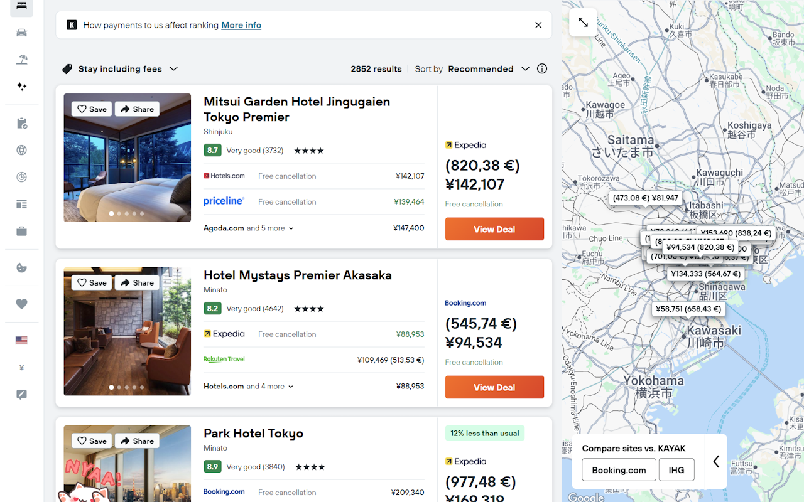

# Live Currency Converter

A browser extension that detects prices in web pages and appends their value in
your home currency, using exchange rates from exchangerate-api.com (refreshed
every 6 hours).

## Settings

On install, a welcome page asks for your home currency (guessed from your
browser language). Nothing is converted until you choose one.

Afterwards, open the popup or the options page:

- **Home currency**: the currency prices are converted into.
- **Source currencies**: the currencies to detect, in priority order. By default
  all 166 currencies supported by exchangerate-api.com are listed, roughly
  sorted by the wealth of their users, with your home currency moved to the
  top. Prices in your home currency are detected but not converted.

Each currency is detected by its ISO code (`JPY`), its symbols (`¥`, `円`) and
its names (`yen`). Some symbols and names are shared, like `$`, `£`, `kr` or
`dollar`. A shared one goes to the currency **highest in the list**, and the
settings show it crossed out on the currencies below. Reorder the list to
choose which currency a shared symbol means.

## Bugs and Feature Requests

Report issues at https://github.com/mathieucaroff/liveCurrencyConverter/issues

## License (JAM License)

> License is hereby granted to use this software and distribute it freely, as long as this copyright notice is retained and modifications are clearly marked.

> ALL WARRANTIES ARE HEREBY DISCLAIMED.

